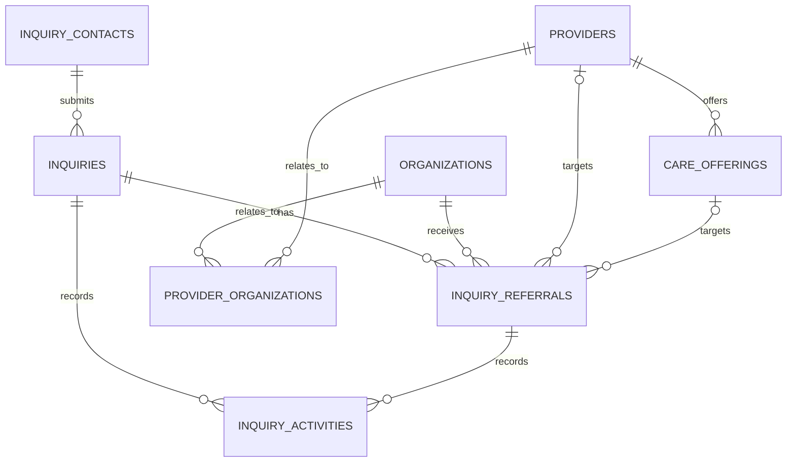

# Lia Inquiry Foundation

Status: approved architecture; schema foundation and `/api/leads` atomic intake implemented and verified locally through 2026-10-13

Scope: family inquiry intake, Lia-side qualification, multi-provider referrals, history, outcomes, and future CRM/Partner Portal compatibility

Out of scope after this checkpoint: public-form redesign, production access/deployment, internal inquiry UI, referral workflow, provider sharing, Partner Portal, full CRM, clinical records

## 1. Approved architecture

V1 has four private tables:

1. `inquiry_contacts` contains the minimum direct contact identifiers.
2. `inquiries` contains one family request, its qualification lifecycle, consent state, and retention metadata.
3. `inquiry_referrals` contains zero or more independent referrals from one inquiry to recipient organizations and optionally their provider/sites and care offerings.
4. `inquiry_activities` contains an append-only operational and audit history without making the system fully event-sourced.

The existing marketplace architecture remains authoritative:

`organization -> provider/site -> care offering -> evidence`

The inquiry architecture adds private demand-side records. It does not change provider facts, publication, verification, availability, capacity, coverage, authorization, or commercial ranking.

### Approved cardinalities and boundaries

- One contact can have many inquiries.
- V1 does not automatically deduplicate contacts by email or phone.
- One inquiry can have zero, one, or many independently progressing referrals.
- Every referral has one required recipient organization.
- A referral may additionally identify one provider/site and one offering belonging to that provider.
- Creating or shortlisting a referral does not mean information was shared.
- Sharing is a separate authorized operation with its own timestamp and activity.
- V1 has no assignee or assignment table.
- Current state is stored on inquiry/referral rows; meaningful changes are also appended as activities.
- No public or generic authenticated role has direct database access to any inquiry table.

## 2. Entity relationship model



Future access remains:

`user -> active organization membership -> organization -> permitted provider/sites`

`provider_organizations` is catalog evidence, not a user authorization table. It can validate that a selected site belongs to or is related to the recipient organization, but it must never grant portal access by itself.

## 3. Exact V1 lifecycle values

### Inquiry lifecycle

Allowed `workflow_status` values:

1. `new`
2. `reviewing`
3. `qualified`
4. `matching`
5. `closed`

Normal forward path:

```text
new -> reviewing -> qualified -> matching -> closed
```

Early closure from `new`, `reviewing`, or `qualified` is allowed when a closure outcome is recorded. A transition to `closed` must fail while any referral is active.

Exact forward transitions are `new -> reviewing|closed`, `reviewing -> qualified|closed`, `qualified -> matching|closed`, and `matching -> closed`. Reopening or moving backwards requires a separately guarded correction operation and a correction activity; it is not an ordinary transition.

Active referral statuses are `shortlisted`, `ready_to_share`, `shared`, and `engaged`. Terminal referral statuses are `converted` and `closed`.

### Referral lifecycle

Allowed `referral_status` values:

1. `shortlisted`
2. `ready_to_share`
3. `shared`
4. `engaged`
5. `converted`
6. `closed`

Normal paths:

```text
shortlisted -> ready_to_share -> shared -> engaged -> converted
     |               |             |          |
     +---------------+-------------+----------+-> closed
```

- `shortlisted`: internal candidate only; no disclosure.
- `ready_to_share`: internal checks are complete; disclosure has not happened.
- `shared`: an authorized, allowlisted payload was actually disclosed.
- `engaged`: the recipient substantively acknowledged or responded.
- `converted`: the referral produced a successful commercial/service outcome.
- `closed`: the referral will not progress; a non-success outcome is required.

Family contact and visit/assessment scheduling are activities, not pipeline statuses. Corrections do not create backwards transitions; they append a correction activity and use a controlled correction operation.

Exact forward transitions are `shortlisted -> ready_to_share|closed`, `ready_to_share -> shared|closed`, `shared -> engaged|closed`, and `engaged -> converted|closed`.

## 4. Exact four-table definitions

The following definitions describe the implemented repository schema. This document is not executable migration SQL. All timestamps are `timestamptz` in UTC. All identifiers default to `gen_random_uuid()`.

### 4.1 `inquiry_contacts`

Purpose: isolate direct identifiers from operational inquiry, referral, and analytics data.

| Column | Nullability/default | Definition |
| --- | --- | --- |
| `id uuid` | PK, not null | Server-generated identifier. |
| `first_name text` | conditionally null | Required before anonymization; trimmed; 1–100 characters. Null after anonymization. |
| `last_name text` | conditionally null | Required before anonymization; trimmed; 1–100 characters. Null after anonymization. |
| `email text` | conditionally null | Required before anonymization; lower-case normalized; maximum 320 characters. Null after anonymization. |
| `phone text` | nullable | Optional normalized E.164 value; null or `+` followed by 7–15 digits. Null after anonymization. |
| `preferred_contact_method text` | conditionally null | `email`, `phone`, or `either`; required before anonymization. Null after anonymization. |
| `created_at timestamptz` | not null, `now()` | Creation time. |
| `updated_at timestamptz` | not null, `now()` | Last contact correction/anonymization time. Trigger-maintained. |
| `anonymized_at timestamptz` | nullable | Irreversible PII disposition time. |

Named checks:

- `inquiry_contacts_identity_state_check`:
  - when `anonymized_at IS NULL`, first name, last name, email, and preferred method are non-null;
  - when `anonymized_at IS NOT NULL`, first name, last name, email, phone, and preferred method are all null.
- `inquiry_contacts_first_name_check`: `first_name = btrim(first_name)` and length 1–100 when present.
- `inquiry_contacts_last_name_check`: `last_name = btrim(last_name)` and length 1–100 when present.
- `inquiry_contacts_email_check`: `email = lower(btrim(email))`, length at most 320, contains one usable `@` boundary, and contains no whitespace when present. Full deliverability validation remains application-side.
- `inquiry_contacts_phone_check`: when present, `phone ~ '^\+[1-9][0-9]{6,14}$'`.
- `inquiry_contacts_preferred_method_check`: value is `email`, `phone`, or `either` when present.
- `inquiry_contacts_phone_preference_check`: `phone` and `either` require non-null `phone`.
- `inquiry_contacts_anonymized_time_check`: `anonymized_at IS NULL OR anonymized_at >= created_at`.

Foreign keys: none.

Uniqueness:

- Primary key only.
- No unique email or phone constraint.

Indexes:

- Primary key only in V1.
- Do not add an email/phone lookup index until an approved internal identity-resolution workflow needs it.

### 4.2 `inquiries`

Purpose: store one family request, its current Lia workflow state, consent/privacy evidence, source, and retention state.

| Column | Nullability/default | Definition |
| --- | --- | --- |
| `id uuid` | PK, not null | Inquiry identifier. |
| `primary_contact_id uuid` | not null | FK to `inquiry_contacts.id`. |
| `care_type_code text` | not null | `ems`, `home_care`, `home_support`, `senior_residence`, `respite`, or `unsure`. |
| `beneficiary_relation_code text` | not null | `self`, `parent`, `partner`, `relative`, `friend`, `other`, or `unspecified`. |
| `timing_code text` | not null | `within_7_days`, `within_1_month`, `within_3_months`, `planning`, or `information_only`. |
| `need_codes text[]` | not null, `'{}'` | Optional controlled high-level needs. |
| `location_text text` | not null | Trimmed coarse locality/region; 2–160 characters; never a street address. |
| `postal_code text` | nullable | Four-digit Swiss postcode when explicitly supplied or deterministically parsed. |
| `municipality_id uuid` | nullable | Reliably resolved municipality only. |
| `context_summary text` | nullable | Trimmed, maximum 1,000 characters; no medical record content. Cleared at anonymization. |
| `workflow_status text` | not null, `new` | Current inquiry lifecycle state. |
| `closure_outcome_code text` | nullable | Required only when closed. |
| `source_channel text` | not null | `homepage`, `manual`, `partner`, `import`, or `other`. |
| `source_detail text` | nullable | Trimmed, maximum 200 characters; no raw query-string dump. |
| `landing_page text` | nullable | Internal route only, maximum 500 characters. |
| `contact_permission_at timestamptz` | not null | Permission for Lia to contact the submitter. |
| `contact_permission_withdrawn_at timestamptz` | nullable | Later withdrawal; does not erase historical evidence. |
| `privacy_notice_version text` | not null | Immutable identifier of notice displayed; 1–80 characters. |
| `privacy_acknowledged_at timestamptz` | not null | When the notice was acknowledged. |
| `provider_sharing_permission_status text` | not null, `not_recorded` | `not_recorded`, `granted`, or `withdrawn`. |
| `provider_sharing_permission_at timestamptz` | nullable | General permission time when granted. |
| `provider_sharing_permission_withdrawn_at timestamptz` | nullable | General permission withdrawal time. |
| `intake_idempotency_key uuid` | nullable | Browser-generated retry key; null only for controlled manual/import flows. |
| `legacy_lead_id text` | nullable | Bounded legacy lineage value after source audit; maximum 200 characters. |
| `submitted_at timestamptz` | not null, `now()` | Original intake time. |
| `closed_at timestamptz` | nullable | Required when closed. |
| `last_activity_at timestamptz` | not null, `now()` | Transactionally maintained queue/retention anchor input. |
| `retention_due_at timestamptz` | nullable | Disposition date; duration is configuration/policy, not a hard-coded check. |
| `anonymized_at timestamptz` | nullable | Inquiry-sensitive-data disposition time. |
| `created_at timestamptz` | not null, `now()` | Row creation time. |
| `updated_at timestamptz` | not null, `now()` | Last snapshot update. Trigger-maintained. |

V1 `need_codes` allowlist:

- `personal_care`
- `meals`
- `medication_support`
- `household_support`
- `companionship`
- `transport`
- `mobility_support`
- `regular_presence`
- `night_support`
- `nursing_care`
- `cognitive_support`
- `unsure`

The public form does not initially collect age band, funding guidance, diagnoses, or a separate situation field. If legacy data makes age/funding preservation legally or operationally necessary, that must be approved after a source-schema audit; it is not silently copied into `context_summary` or `event_data`.

Inquiry closure outcome values:

- `care_started`
- `admission_or_placement`
- `other_success`
- `resolved_without_referral`
- `family_withdrew`
- `unreachable`
- `duplicate`
- `out_of_scope`
- `no_solution_found`
- `other`

Named checks:

- `inquiries_care_type_check`: exact care-type allowlist above.
- `inquiries_beneficiary_relation_check`: exact relationship allowlist above.
- `inquiries_timing_check`: exact timing allowlist above.
- `inquiries_need_codes_check`: no null elements, maximum 12 elements, and array is contained by the exact need-code allowlist. The create/update transaction additionally rejects duplicates and stores a canonical order.
- `inquiries_location_check`: `location_text = btrim(location_text)` and length 2–160.
- `inquiries_postal_code_check`: null or `^[0-9]{4}$`.
- `inquiries_context_summary_check`: null or trimmed length 1–1,000.
- `inquiries_workflow_status_check`: `new`, `reviewing`, `qualified`, `matching`, or `closed`.
- `inquiries_closure_outcome_check`: null or one of the ten exact values above.
- `inquiries_closure_state_check`: closed requires both `closed_at` and `closure_outcome_code`; non-closed requires both null.
- `inquiries_source_channel_check`: exact source-channel allowlist above.
- `inquiries_source_detail_check`: null or trimmed length 1–200.
- `inquiries_landing_page_check`: null or length 1–500 and begins with `/`; reject absolute URLs and query strings in the server operation.
- `inquiries_contact_permission_check`: withdrawal is null or at/after permission.
- `inquiries_privacy_notice_check`: version is trimmed and length 1–80; the create-inquiry operation records `privacy_acknowledged_at = submitted_at` using the database transaction timestamp rather than trusting a client timestamp.
- `inquiries_provider_sharing_permission_check`:
  - `not_recorded` means both provider-sharing timestamps are null;
  - `granted` means permission time is non-null and withdrawal is null;
  - `withdrawn` means both are non-null and withdrawal is at/after permission.
- `inquiries_activity_time_check`: `last_activity_at >= created_at`.
- `inquiries_retention_time_check`: `retention_due_at IS NULL OR retention_due_at >= created_at`.
- `inquiries_anonymization_check`: when `anonymized_at` is non-null, `context_summary` and `source_detail` are null.
- `inquiries_legacy_lead_id_check`: null or trimmed length 1–200.

Foreign keys:

- `primary_contact_id -> inquiry_contacts.id ON DELETE RESTRICT`.
- `municipality_id -> municipalities.id ON DELETE RESTRICT`.

Uniqueness:

- Primary key.
- Unique partial index on `intake_idempotency_key` where non-null.
- Unique partial index on `legacy_lead_id` where non-null.

Indexes:

- `(workflow_status, created_at, id)`.
- `(primary_contact_id, created_at DESC, id)`.
- `(municipality_id, workflow_status)` where municipality is non-null.
- `(retention_due_at, id)` where retention due is non-null and anonymized is null.

Cross-row rule:

- A guarded transition function and defensive trigger reject `workflow_status = 'closed'` while any related referral has an active status.

### 4.3 `inquiry_referrals`

Purpose: represent each independent Lia-to-organization referral and its disclosure, response, conversion, or closure state.

| Column | Nullability/default | Definition |
| --- | --- | --- |
| `id uuid` | PK, not null | Referral identifier. |
| `inquiry_id uuid` | not null | Parent inquiry. |
| `recipient_organization_id uuid` | not null | Recipient and future authorization boundary. |
| `provider_id uuid` | nullable | Optional target provider/site. |
| `care_offering_id uuid` | nullable | Optional offering belonging to the target provider. |
| `referral_status text` | not null, `shortlisted` | Current referral lifecycle state. |
| `outcome_code text` | nullable | Required for `converted` or `closed`; status-specific. |
| `sharing_authorization_basis text` | nullable | `general_permission` or `referral_specific_permission`. |
| `sharing_authorized_at timestamptz` | nullable | Per-referral record that disclosure was authorized. |
| `sharing_authorization_withdrawn_at timestamptz` | nullable | Withdrawal before or after disclosure; blocks a new disclosure when already present. |
| `shared_at timestamptz` | nullable | First actual disclosure time; set once. |
| `responded_at timestamptz` | nullable | First substantive recipient response. |
| `converted_at timestamptz` | nullable | Successful conversion time. |
| `closed_at timestamptz` | nullable | Non-success closure time. |
| `created_at timestamptz` | not null, `now()` | Creation time. |
| `updated_at timestamptz` | not null, `now()` | Last snapshot update. Trigger-maintained. |

Successful `converted` outcome values:

- `care_started`
- `admission_or_placement`
- `other_success`

Non-success `closed` outcome values:

- `provider_declined`
- `family_declined`
- `no_response`
- `unavailable`
- `unsuitable`
- `withdrawn`
- `duplicate`
- `other`

Named checks:

- `inquiry_referrals_status_check`: `shortlisted`, `ready_to_share`, `shared`, `engaged`, `converted`, or `closed`.
- `inquiry_referrals_outcome_check`: null or one of the eleven exact referral outcomes above.
- `inquiry_referrals_provider_offering_pair_check`: `care_offering_id IS NULL OR provider_id IS NOT NULL`.
- `inquiry_referrals_sharing_authorization_pair_check`: authorization basis and timestamp are either both null or both non-null; basis is one of the two exact values; withdrawal requires prior authorization and is at/after authorization.
- `inquiry_referrals_shared_state_check`:
  - `shared`, `engaged`, and `converted` require authorization basis, authorization time, and `shared_at`;
  - `shortlisted` and `ready_to_share` require `shared_at IS NULL`;
  - `closed` may be pre-share or post-share, but a non-null `shared_at` requires authorization fields;
  - when both withdrawal and sharing exist, withdrawal must be at or after `shared_at`, proving authorization had not been withdrawn before disclosure.
- `inquiry_referrals_response_check`: `responded_at IS NULL OR shared_at IS NOT NULL`, and `engaged` or `converted` requires `responded_at`.
- `inquiry_referrals_converted_state_check`: `converted` requires `converted_at`, no `closed_at`, and a successful outcome; every other status requires `converted_at IS NULL`.
- `inquiry_referrals_closed_state_check`: `closed` requires `closed_at`, no `converted_at`, and a non-success outcome; every other status requires `closed_at IS NULL`.
- `inquiry_referrals_active_outcome_check`: `shortlisted`, `ready_to_share`, `shared`, and `engaged` require `outcome_code IS NULL`.
- `inquiry_referrals_milestone_order_check`: authorization cannot predate referral creation; sharing cannot predate authorization; response cannot predate sharing; conversion/closure cannot predate creation.

Foreign keys:

- `inquiry_id -> inquiries.id ON DELETE RESTRICT`.
- `recipient_organization_id -> organizations.id ON DELETE RESTRICT`.
- `provider_id -> providers.id ON DELETE RESTRICT`.
- Composite `(provider_id, care_offering_id) -> care_offerings(provider_id, id) ON DELETE RESTRICT`.

Add `UNIQUE (inquiry_id, id)` so activities can enforce that their optional referral belongs to the same inquiry.

Active-referral uniqueness:

- Unique partial index on `(inquiry_id, recipient_organization_id)` where `provider_id IS NULL` and status is not `converted` or `closed`.
- Unique partial index on `(inquiry_id, recipient_organization_id, provider_id)` where `provider_id IS NOT NULL` and status is not `converted` or `closed`.

These prevent duplicate active work but allow a later, intentionally new referral after a terminal result.

Indexes:

- `(inquiry_id, referral_status, created_at, id)`.
- `(recipient_organization_id, referral_status, created_at, id)`.
- `(provider_id, referral_status, created_at)` where provider is non-null.
- `(shared_at, id)` where shared is non-null.

Provider/organization validation:

- The recipient organization, provider, and offering must have active lifecycle status at referral creation. Publication and verification are separate facts and are not inferred or changed.
- If `provider_id` is null, the referral is addressed to the organization centrally.
- If `provider_id` is present, the create/update operation must find a direct `provider_organizations` row for the selected recipient organization and provider with relationship type `operator`, `owner`, or `brand`. A `network` relationship alone is not evidence that the organization is responsible for receiving a site-specific referral. The operation never auto-selects among relationships.
- If `care_offering_id` is present, the composite FK proves that it belongs to the provider.
- A provider without an organization relationship is not eligible for a provider-targeted referral. Resolve the catalog identity first or create a justified organization-only referral to an existing recipient organization; never weaken `recipient_organization_id`.
- Organization membership and site permission will be separate future authorization facts.

### 4.4 `inquiry_activities`

Purpose: immutable operational/audit history. Current states remain queryable directly from inquiry/referral rows.

| Column | Nullability/default | Definition |
| --- | --- | --- |
| `id uuid` | PK, not null | Activity identifier. |
| `inquiry_id uuid` | not null | Parent inquiry. |
| `referral_id uuid` | nullable | Optional referral context. |
| `activity_type text` | not null | Controlled event type below. |
| `actor_type text` | not null | `system` or `lia_staff` in V1. |
| `actor_label text` | not null | Non-sensitive bounded service/staff label, 1–120 characters. |
| `visibility_scope text` | not null, `lia_internal` | Only `lia_internal` in V1. Future portal visibility requires a migration and policy review. |
| `from_status text` | nullable | Prior status for transition events. |
| `to_status text` | nullable | New status for transition events. |
| `note_text text` | nullable | Trimmed operational note, maximum 1,000 characters; no clinical notes. |
| `event_data jsonb` | not null, `'{}'` | Small allowlisted object; no contact data or unbounded payload. |
| `related_activity_id uuid` | nullable | Prior activity corrected/superseded by this immutable activity. |
| `occurred_at timestamptz` | not null, `now()` | Business event time. |
| `created_at timestamptz` | not null, `now()` | Insert time. |

Exact V1 activity types:

- `inquiry_created`
- `inquiry_status_changed`
- `contact_permission_changed`
- `provider_sharing_permission_changed`
- `contact_attempted`
- `note_added`
- `referral_created`
- `referral_status_changed`
- `referral_sharing_authorized`
- `referral_sharing_authorization_withdrawn`
- `referral_shared`
- `provider_response_recorded`
- `family_contact_recorded`
- `visit_scheduled`
- `outcome_recorded`
- `correction_recorded`
- `retention_action_recorded`

Named checks:

- `inquiry_activities_type_check`: exact activity allowlist above.
- `inquiry_activities_actor_type_check`: `system` or `lia_staff`.
- `inquiry_activities_actor_label_check`: trimmed length 1–120.
- `inquiry_activities_visibility_check`: exactly `lia_internal` in V1.
- `inquiry_activities_status_pair_check`: `from_status` and `to_status` are both null or both non-null; they are required for inquiry/referral status-change activities and null otherwise.
- `inquiry_activities_referral_scope_check`: referral activity types require `referral_id`; inquiry-only activity types require it to be null. `note_added`, `correction_recorded`, `outcome_recorded`, and `retention_action_recorded` may be inquiry- or referral-scoped.
- `inquiry_activities_note_check`: null or trimmed length 1–1,000; only `note_added`, `correction_recorded`, `provider_response_recorded`, `family_contact_recorded`, and `visit_scheduled` may contain it.
- `inquiry_activities_event_data_check`: JSON object and serialized size at most 8 KiB. Each transaction operation applies an activity-specific key allowlist.
- `inquiry_activities_time_check`: `occurred_at <= created_at`; both use database time for current events, while an approved import may supply an earlier occurrence time.
- Insert-only enforcement: reject ordinary `UPDATE` and `DELETE`; corrections append a related activity.

Foreign keys:

- `inquiry_id -> inquiries.id ON DELETE RESTRICT`.
- Composite `(inquiry_id, referral_id) -> inquiry_referrals(inquiry_id, id) ON DELETE RESTRICT` when referral is present.
- Composite `(inquiry_id, related_activity_id) -> inquiry_activities(inquiry_id, id) ON DELETE RESTRICT` when a related activity is present.

Add `UNIQUE (inquiry_id, id)` so a correction cannot point to an activity belonging to another inquiry.

Indexes:

- `(inquiry_id, occurred_at DESC, id DESC)`.
- `(referral_id, occurred_at DESC, id DESC)` where referral is non-null.
- `(activity_type, occurred_at DESC)`.

Individual authenticated actor IDs are deliberately not part of V1. When staff authentication exists, add a nullable actor-user FK and preserve this table's meaning. Assignments use a later `inquiry_assignments` table, not an inquiry column.

## 5. Provider-category compatibility audit

A guarded read-only query against `Lia-vaud:local:54322` on 2026-10-12 checked all current providers, offerings, and `provider_organizations` rows. Production was not accessed.

| Category | Providers | Providers with an organization | Providers with an offering | Offering-backed providers without an organization |
| --- | ---: | ---: | ---: | ---: |
| Domicile | 87 | 80 | 80 | 0 |
| EMS | 46 | 31 | 31 | 0 |
| Residence | 8 | 0 | 0 | 0 |
| Total | 141 | 111 | 111 | 0 |

Conclusion:

- Every currently implemented offering-backed provider has at least one organization relationship. Required recipient organization is compatible with all current referral-ready supply.
- All 111 offering-backed providers have an `operator`, `owner`, or `brand` relationship suitable for provider-target validation: 61 currently have only `operator`, while 50 CMS have both `operator` and `network`. No offering-backed provider relies on `network` alone.
- Thirty legacy/held providers have no organization relationship and no offering: 7 domicile, 15 EMS, and 8 residence records.
- All eight current residence records therefore remain incompatible with a provider-targeted referral until the planned residence-universe work establishes their organization and offering architecture.
- The same restriction applies to the held/legacy domicile and EMS rows without organizations.
- This is a catalog-readiness requirement, not a reason to make referral organization nullable.

Before provider-targeted referral creation, the application must require an organization relationship and must make staff choose the recipient organization explicitly when several relationships exist.

## 6. Consent and sharing representation

Three concepts remain logically separate:

1. `privacy_acknowledged_at` plus `privacy_notice_version` proves which notice was presented and acknowledged.
2. `contact_permission_at` plus optional withdrawal records whether Lia may contact the family.
3. Provider-sharing permission records whether Lia may disclose necessary request information.

An inquiry may hold general provider-sharing permission, including its current granted/withdrawn state. That permission never marks a referral as shared.

Each referral separately stores:

- `sharing_authorization_basis`;
- `sharing_authorized_at`;
- `shared_at` only after actual disclosure;
- a `referral_sharing_authorized` activity;
- a later `referral_shared` activity.

For `general_permission`, the authorization operation must verify that the inquiry's general permission is currently granted, then snapshot that basis/time onto the referral. For `referral_specific_permission`, the operation records that the family specifically authorized this referral. Later withdrawal prevents new sharing; it does not rewrite the historical fact that an earlier disclosure occurred.

Creating, shortlisting, or moving to `ready_to_share` never constitutes disclosure.

Future Partner Portal sharing should create an immutable, versioned referral share snapshot containing only approved fields. The portal must read that snapshot, not the live inquiry/contact rows. Snapshot tables and portal policies are architected for later and are not part of V1.

## 7. Data minimization and public intake

### Initial public fields

- first name;
- last name;
- email;
- optional phone;
- preferred contact method;
- broad care type;
- beneficiary relationship;
- timing/urgency band;
- coarse location and optional postcode;
- optional reliably resolved municipality;
- optional controlled high-level need codes;
- optional context summary capped at 1,000 characters;
- bounded acquisition/source metadata;
- contact permission and versioned privacy evidence.

Provider-sharing permission may be requested separately when Lia is ready to share with selected providers. It must not be silently bundled into the intake privacy acknowledgement.

Age band and funding-guidance category are not in the initial public form or V1 core columns. They require a later demonstrated need. The same applies to the current broad `situation` step.

### Information V1 must explicitly discourage and not model

- diagnoses;
- medication names, dosages, or schedules;
- AVS numbers;
- insurance policies or records;
- medical documents;
- detailed clinical histories;
- detailed care plans;
- date of birth;
- street address.

High-level need codes and context can still reveal health-related circumstances. They remain private, optional, purpose-limited, bounded, and subject to retention/anonymization.

## 8. Closure and outcome strategy

`workflow_status` answers where Lia's overall inquiry is now. `referral_status` answers where one recipient referral is now. `outcome_code` explains a terminal state without creating dozens of pipeline statuses.

Rules:

- Inquiry `closed` requires `closure_outcome_code` and `closed_at`.
- Inquiry closure fails while any referral is `shortlisted`, `ready_to_share`, `shared`, or `engaged`.
- Referral `converted` requires `converted_at` and a successful outcome.
- Referral `closed` requires `closed_at` and a non-success outcome.
- Inquiry outcome does not have to equal any one referral outcome, but a successful inquiry outcome should normally be supported by at least one converted referral or an explicitly recorded `resolved_without_referral` path.
- `unavailable` is a historical outcome of one referral at one time. It must not update provider availability facts.
- Terminal corrections append activities and use an explicit guarded correction operation.

## 9. RLS, grants, and security

### Table posture

For all four tables:

- enable RLS;
- revoke all privileges from `PUBLIC`, `anon`, and `authenticated`;
- create no anonymous or authenticated table policies in V1;
- grant required CRUD privileges only to `service_role`;
- keep all transaction functions unavailable to `PUBLIC`, `anon`, and `authenticated`, and executable only by `service_role`;
- make any `SECURITY DEFINER` function owner-controlled with a fixed safe `search_path`, schema-qualified objects, no caller-selected relation names, and explicit privilege revocation;
- ensure the Next.js service client is explicitly server-only;
- never log request bodies, names, emails, phone numbers, context summaries, or activity notes.

| Table | V1 inserts | V1 reads | V1 updates | V1 deletes |
| --- | --- | --- | --- | --- |
| `inquiry_contacts` | Validated server intake | Lia server operations | Controlled correction/anonymization | Retention operation only if hard deletion is later approved |
| `inquiries` | Validated server intake/import | Lia server operations | Guarded lifecycle/consent/retention operations | Retention operation only if approved |
| `inquiry_referrals` | Guarded Lia referral operation | Lia server operations | Guarded authorization/lifecycle operations | No ordinary deletion |
| `inquiry_activities` | Guarded operations only | Lia server operations | Never | Never ordinarily; retention/legal deletion only through a separately approved operation |

The browser's POST to `/api/leads` is not a direct database grant. Service-role bypass of RLS makes server validation, fixed transaction functions, secret isolation, request-size limits, abuse controls, and idempotency mandatory.

Future organization policies must require active membership in `recipient_organization_id`, explicit sharing, any provider/site scope, and a field/activity visibility allowlist. They must never expose `inquiry_contacts` or base `inquiries` directly.

## 10. Transaction boundaries

The future migration should create narrowly scoped transactional functions or equivalent single-transaction repository operations. No multi-step workflow may rely on separate HTTP/database commits.

### Create inquiry

One transaction:

1. lock/check `intake_idempotency_key`;
2. validate and normalize the complete payload;
3. insert `inquiry_contacts`;
4. insert `inquiries`;
5. insert `inquiry_created` activity;
6. set consistent `created_at`, `submitted_at`, and `last_activity_at`;
7. return inquiry ID/reference;
8. commit.

The same idempotency key returns the existing result and never creates a second contact or inquiry.

### Change inquiry status

One transaction:

1. lock inquiry;
2. validate allowed transition;
3. if closing, confirm no active referrals;
4. validate closure outcome;
5. update inquiry snapshot and `last_activity_at`;
6. append `inquiry_status_changed` and, where appropriate, `outcome_recorded`;
7. commit.

### Create referral

One transaction:

1. lock/read inquiry and reject anonymized/closed inquiries;
2. validate organization, optional provider relationship, and optional offering ownership;
3. enforce active-referral uniqueness;
4. insert as `shortlisted`;
5. append `referral_created`;
6. update inquiry `last_activity_at` and optionally advance a qualified inquiry to `matching` with its own activity;
7. commit.

### Authorize and share referral

Authorization and actual disclosure are separate operations.

Authorization transaction:

1. lock inquiry and referral;
2. require referral is not terminal or already shared;
3. validate `general_permission` against current inquiry permission, or record specific permission evidence;
4. set referral authorization basis/time;
5. append `referral_sharing_authorized`;
6. update `last_activity_at`;
7. commit.

A pre-disclosure withdrawal transaction locks the referral, sets `sharing_authorization_withdrawn_at`, appends `referral_sharing_authorization_withdrawn`, and prevents the sharing transaction. A later withdrawal after historical disclosure records the family's current instruction but does not erase `shared_at` or the disclosure activity.

Sharing-record transaction:

1. lock inquiry and referral;
2. require status `ready_to_share`;
3. require non-withdrawn valid authorization;
4. require the caller to attest that an authorized manual disclosure has already completed and provide its actual occurrence time, not later than transaction time;
5. set status `shared` and immutable first `shared_at` to that occurrence time;
6. append `referral_shared` with the same occurrence time and an idempotency key;
7. update `last_activity_at`;
8. commit.

V1 does not send family data to providers automatically and does not need an outbox. If automated delivery or the Partner Portal is later authorized, add a versioned share snapshot and delivery/outbox model before changing this operation. Never mark a referral shared merely because it was created, shortlisted, ready, or queued for a future delivery.

### Change referral status

One transaction locks referral/inquiry, validates the forward transition and required milestones/outcome, updates the referral, appends `referral_status_changed` plus any `outcome_recorded`, updates inquiry `last_activity_at`, and commits.

### Consent changes and corrections

Each permission grant/withdrawal or data correction updates the current snapshot and appends the matching activity in the same transaction. Withdrawal blocks future disclosures but does not erase historical `shared_at` facts.

### Retention/anonymization

One controlled transaction locks the contact and all linked inquiries, verifies every linked record is eligible, clears direct contact identifiers and sensitive free text, sets anonymization timestamps, and appends non-identifying retention activities. If one contact has another inquiry that is not due, do not anonymize the shared contact yet; the due inquiry can have its sensitive text cleared independently.

## 11. Retention and deletion

V1 includes `retention_due_at` and anonymization capability, but no final duration is encoded in a check, default, or trigger.

Before production, privacy/legal approval must define:

- the duration;
- whether the anchor is submission, closure, or last useful activity;
- pause/exception rules;
- when to anonymize versus hard-delete;
- which non-identifying aggregate funnel fields may remain;
- treatment of Resend copies, application logs, backups, and imported legacy rows.

Approved structural behavior:

- Contact anonymization removes names, email, phone, and preference.
- Inquiry anonymization removes `context_summary` and potentially identifying source detail.
- Non-identifying statuses, source channel, timestamps, organization/provider references, and outcome codes may remain only if the final policy permits.
- Soft deletion must not become indefinite hidden retention.
- Restrictive FKs prevent accidental cascade loss of funnel/referral history; a future legally required hard deletion must execute in explicit dependency order.

## 12. `/api/leads` migration strategy

### Current role and risks

`app/api/leads/route.js` is the current public compatibility endpoint. It validates presence of the legacy form fields, inserts one `public.leads` row through a service-role client, then sends a Resend email containing contact and intake information.

Known concerns:

- no repository migration defines `public.leads`, and it is absent from the verified local database;
- production schema/data is unknown and was not accessed;
- validation lacks complete type, controlled-value, length, normalization, request-size, abuse, and idempotency controls;
- notification failure after a committed insert can appear to the client as submission failure and lead to duplicate retry;
- email duplicates PII and potentially health-related context into another system;
- current form requires age, funding, situation, and phone and lacks preferred contact method and separate provider-sharing semantics.

### Approved compatibility approach

Keep `POST /api/leads` during V1. Preserve its successful response contract while replacing the backend with the guarded create-inquiry transaction.

Deployment sequence:

1. Add and locally verify the new schema/functions in a separately approved migration.
2. Add a server-only inquiry service with strict payload schemas, controlled mappings, a request-size limit, idempotency, and safe logging.
3. Make `/api/leads` accept the legacy payload plus the new optional fields during a compatibility window.
4. Map known care, urgency, and need choices to controlled codes. Never infer municipality, provider, offering, authorization, or referral.
5. For a legacy request without preferred contact method, use a documented compatibility default of `email` because email is already required; do not infer a phone preference.
6. Deploy the lean form in the same release: phone optional, preferred method required, age/funding/situation steps removed, need codes and context optional, 1,000-character limit, stronger “no medical records” guidance.
7. Continue accepting deprecated age/funding/situation keys briefly for old clients but do not copy them into context or activity JSON. End the compatibility window after the deployed form population has aged out.
8. Create no referral during intake.
9. Commit contact, inquiry, and initial activity before notification. Notification failure must not change a successful intake response or cause re-insertion.
10. Minimize notification content; prefer inquiry reference/link over emailing the full request. Add an outbox later only if delivery reliability requires it.
11. Introduce `/api/inquiries` later, migrate callers, then retire `/api/leads` separately.

### Implemented `/api/leads` compatibility mapping

The local application implementation uses `public.create_inquiry_from_public_intake`, a
`SECURITY INVOKER` RPC executable only by `service_role`. The role already has the narrowly
required table privileges, so the function does not need owner-bypassing `SECURITY DEFINER`
authority. One transaction serializes on `intake_idempotency_key`, creates one contact, one
`new` inquiry, and one `inquiry_created` activity, and creates no referral or disclosure.

| Legacy input | Inquiry Foundation value |
| --- | --- |
| `firstName`, `lastName`, `email`, optional `phone` | Normalized contact fields; missing preference defaults to `email`. |
| `need` | Exact controlled mapping to `care_type_code`. |
| `urgency` | Exact controlled mapping to `timing_code`. |
| No relationship field | `beneficiary_relation_code = unspecified`. |
| `needs[]` | Exact controlled mapping, canonical sorting, and deduplication into `need_codes`. |
| `location` | `location_text` only; no municipality inference. |
| `details` | Optional trimmed `context_summary`, maximum 1,000 characters. |
| `source = landing`, `page = homepage` | `source_channel = homepage`, `source_detail = landing`, `landing_page = /`. |
| `consentContact = true` | Contact permission at the server transaction time. |

The legacy `situation`, `age`, and `funding` values are deprecated compatibility fields.
They remain exact-allowlist validated while the old form is live, but are intentionally not
persisted in a core column, free text, or activity metadata.

The contact checkbox establishes permission for Lia to contact the submitter. The adjacent
submission notice states that sending the form accepts Lia's processing of the supplied
information and links the privacy policy. Together, that displayed wording is recorded as
privacy-notice version `homepage-intake-2026-10-13`. This server-owned constant must change
whenever the relevant checkbox, submission notice, or linked privacy notice materially
changes. It does not establish or imply provider-sharing permission.

The browser sends one random UUID in `Idempotency-Key` for a submission attempt, retains it
across an ambiguous retry, and clears it when the payload is edited or success is confirmed.
The RPC compares canonical persisted intake/contact values. An exact retry returns the
existing inquiry without new rows; reuse with different canonical values raises an
idempotency conflict. Email and phone are never identity or idempotency keys.

### Legacy lead data

Before any backfill, a separately authorized read-only source audit must establish the actual legacy schema, IDs, counts, timestamps, status values, nulls, consent evidence, and retention eligibility. Production must not be inferred from local history.

Backfill rules:

- one legacy lead initially creates one contact and one inquiry; no automatic person deduplication;
- preserve lineage in `legacy_lead_id` only after its source type/length is known;
- map only exact approved values; quarantine unknowns;
- create an import/inquiry-created activity without copying raw PII into activity data;
- never infer referrals, organizations, providers, municipalities, consent versions, or sharing;
- do not fabricate privacy-notice version or consent timestamps when the source cannot prove them;
- age/funding/situation handling requires a specific preservation decision after the source audit; do not repurpose them into free text;
- keep the legacy table read-only during reconciliation and remove it only in a later approved retention-aware step.

## 13. Future CRM and Partner Portal compatibility

The four core tables retain stable meanings while later capabilities are additive:

| Future capability | Additive design |
| --- | --- |
| Organization members | User-to-organization membership tables. |
| Site permissions | Membership-to-provider/site scope tables. |
| Assignments | History-preserving `inquiry_assignments`; no inquiry assignee column. |
| Tasks | Separate task entity with owner, due date, state, and completion. |
| Notes | Bounded internal activities; later visibility-specific notes if needed. |
| Admissions pipeline | Separate admission/application entity linked to a referral. |
| Response analytics | Referral statuses, `shared_at`, `responded_at`, outcomes, and activities. |
| Conversion analytics | `converted`, `converted_at`, successful outcome codes, source, and timestamps. |
| Partner Portal | Memberships, site scopes, immutable share snapshots, portal-safe views/RPCs, and access audit. |
| External CRM | Separate system/entity ID mapping plus outbound/inbound adapter. |

External systems must call the same guarded lifecycle operations. They must not write core tables directly or add vendor-specific columns to them.

## 14. Implementation and test sequence

Steps 1–7 and the schema-focused parts of steps 11–15 were completed locally in the separately authorized schema-foundation workflow. Application steps remain separately gated.

1. Approve the final review items in section 16.
2. Create a clean checkpoint/backup under the established Lia process before schema work.
3. Draft one reversible Inquiry Foundation migration containing only the four tables, helper/transition functions, triggers, indexes, grants, and RLS posture.
4. Add SQL tests for every check, FK, partial unique index, insert-only activity rule, active-referral closure guard, provider-organization validation, and privilege/RLS boundary.
5. Run migration rollback-only against `Lia-vaud:local:54322` and prove the existing 16 public tables and all provider/catalog fingerprints remain unchanged.
6. Apply locally and verify exact schema objects, constraints, indexes, grants, policies, and zero inquiry rows.
7. Roll back and compare exact predecessor schema/data fingerprints, then reapply.
8. Add a server-only inquiry repository/service and unit tests for normalization, code mappings, idempotency, transaction failure, and safe logging.
9. Refactor `/api/leads` as the compatibility façade and add route tests for accepted payloads, rejected values/lengths, idempotent retry, database failure, and notification failure after commit.
10. Update the public form and add UI/validation tests for optional phone, preferred method, removed deferred fields, optional need codes/context, the 1,000-character cap, privacy evidence, and medical-data warning.
11. Add lifecycle integration tests covering multiple referrals, independent outcomes, required organization, optional provider/offering, sharing authorization, explicit `shared_at`, converted/closed outcomes, and blocked inquiry closure.
12. Add retention/anonymization tests, including one contact with multiple inquiries where only one is due.
13. Run targeted tests, the full runnable suite, targeted ESLint, and `git diff --check`.
14. Update documentation/state only after local verification.
15. Commit the migration/schema foundation separately from application changes unless an atomic deployment plan proves they must ship together.
16. Do not deploy or backfill production until a separate production schema audit, privacy/legal retention decision, deployment plan, and explicit authorization exist.

## 15. Rollback strategy

### Before application use or data creation

The migration down/rollback path may drop, in dependency order:

1. inquiry functions and triggers;
2. `inquiry_activities`;
3. `inquiry_referrals`;
4. `inquiries`;
5. `inquiry_contacts`;

It must remove only Inquiry Foundation objects and restore prior grants/functions exactly. Provider/catalog tables and data remain untouched.

### After application writes exist

Do not drop populated inquiry tables as routine rollback.

- Disable the new write path and return `/api/leads` to the prior implementation only if the prior storage target is known safe and compatible.
- Preserve new inquiry records read-only.
- Fix forward for constraint/function/application defects.
- If a schema reversal is legally or operationally necessary, export and verify the private records under an approved encrypted procedure, reconcile every ID/count, then perform a separately reviewed migration.
- Notification rollback must not resend or recreate inquiries.
- Legacy backfill is independently reversible by lineage ID only before any new activities/referrals attach; otherwise use a corrective forward migration.

### Required rollback proof

For the eventual local migration workflow:

- rollback-only dry run;
- apply;
- verify;
- rollback;
- exact predecessor schema/data/grant comparison;
- reapply;
- final zero-drift provider/catalog fingerprint check.

## 16. Remaining later-stage decisions

The core architecture, all controlled vocabularies in this document, and the nullable general provider-sharing permission/evidence fields are approved for the V1 schema migration. These later-stage items remain deliberately outside the schema-foundation implementation:

1. Before production, approve retention duration/anchor, anonymization versus deletion, exceptions, and downstream copies/backups.
2. Before legacy backfill, audit and approve the real source schema and mapping, including unverifiable legacy consent and deferred age/funding/situation values.
3. Before production, resolve privacy notice/legal-basis, hosting/subprocessor/transfer, production contact, abuse-control, and operational-monitoring requirements.
4. Before any Partner Portal work, approve membership, site permission, immutable share snapshot, portal RLS, and read-access audit designs.

The schema foundation is implemented only in the verified local database. No production storage, application write path, or provider sharing is authorized by this checkpoint.
